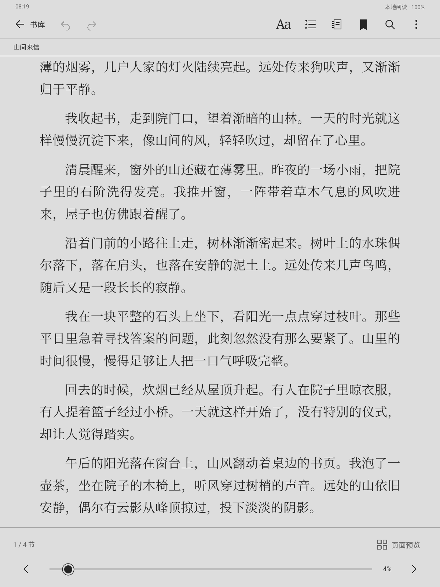
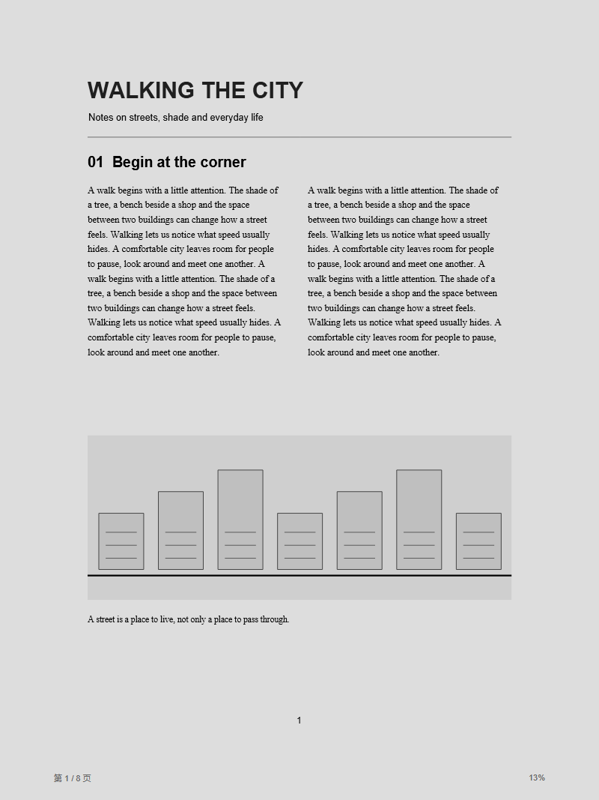

# 墨阅 · Moyue Reader

面向 Android 平板的离线阅读器，以 Kindle 式简洁书库、灰色纸面与分页阅读为设计目标。当前版本 **1.2.0**（versionCode 11），应用 ID 为 `cn.moyue.reader`。

本项目独立开发，与 Amazon / Kindle 无隶属关系。普通平板上的灰纸和刷新效果是软件模拟，不会把 LCD 变成电子纸，也不代表调用了设备的硬件刷新接口。

## 界面

以下为应用实际运行截图，使用项目原创示例书籍。

 

## 功能

| 类别 | 当前能力 |
| --- | --- |
| 导入 | PDF、EPUB、DOCX、DOC、TXT、HTML；MD 按纯文本阅读 |
| 书库 | 封面、搜索、排序、收藏集、阅读进度与已读状态 |
| 阅读 | 分页、目录、书签、位置历史、脚注预览、单书排版、自定义主题与离线字体 |
| 纸面 | 默认中性灰 #DDDDDD，可选暖纸/夜间；白场停留、字迹加深、模拟整屏刷新 |
| PDF | PDF.js 与 Android 原生兼容引擎；缩放、旋转、裁边、分栏、缩略图、文字层搜索 |
| 批注 | 划线、笔记、删除、调整范围、跨页扩选、全部批注搜索 |
| 词典 | StarDict 离线词典导入、选词查询、多词典管理 |
| 生词 | 原句与来源、手动/自动收录、卡片复习、到期筛选、学习状态重置 |
| 搜索 | 书库全文搜索，包含有文字层的 PDF；持久索引、取消与缓存清理 |
| 数据 | 本地保存，.moyue 完整备份、校验与恢复 |

应用不申请 INTERNET 权限，无账号、云端服务或遥测。书籍原文件及阅读数据保存在应用私有存储中；卸载或清除应用数据会移除它们，请先导出备份。

## 安装

要求 **Android 8.0 / API 26 及以上**，以及 **Chromium 110 及以上的系统 WebView**。

安装包下载见 [Releases](https://github.com/Camellia0128/moyue-reader/releases)。在平板文件管理器打开 APK，按系统提示允许该来源安装。更新需用相同签名的安装包覆盖，并提前导出备份。详见 [安装、升级与排障](docs/INSTALL.md)。

## 从源码构建

准备 Node.js 22+（含 npm）、JDK 17、Android SDK Platform 35 和 Build Tools 34.0.0。Gradle Wrapper 已包含，首次安装依赖和构建需要联网；APK 运行无需网络。

```sh
git clone https://github.com/Camellia0128/moyue-reader.git
cd moyue-reader
npm ci
npm run build:web
npm test
```

设置 JAVA_HOME、ANDROID_HOME 后：

```powershell
# Windows：输出 release/墨阅-1.0.0-debug.apk
.\build-apk.ps1 -DebugOnly
```

```sh
# Linux / macOS：输出 app/build/outputs/apk/debug/app-debug.apk
chmod +x gradlew
./gradlew :app:assembleDebug :app:lintDebug
```

调试包与正式包签名不同，不能直接互相覆盖。正式签名、CI、SDK 配置和浏览器预览见 [构建与发布指南](docs/BUILD.md)。无需部署服务器，APK 安装就是客户端部署。

## 限制

- 不支持受 DRM 保护的 Kindle / Amazon 电子书，不提供 DRM 移除；当前没有 MOBI、AZW、AZW3、KFX 解析器。
- 扫描 PDF 无文字层时可看页面，但不能直接选字或全文搜索；未内置 OCR。
- Word 复杂版式可能与 Office 有差异；EPUB 的脚本及交互内容不执行。
- StarDict 支持 32 位 .idx，搭配 .ifo 与 .dict / .dict.dz，可选 .syn；不支持 .idx.gz 或 64 位索引。不附带商业词典。
- 单本导入上限 100 MB；完整备份原文件合计上限 1 GB。词典与字体不包含在完整备份内，需另行保管和重新导入。
- 搜索磁盘缓存上限约 64 MB（文本载荷），内存文本缓存约 2 MB。大图片会降采样或显示占位；复杂文档仍受设备内存限制。
- 当前没有百度网盘自动同步、Amazon 账号导入、跨设备同步或厂商专用电子纸驱动。

## 开发与许可

见 [架构与数据](docs/ARCHITECTURE.md)、[参与贡献](CONTRIBUTING.md)、[更新记录](CHANGELOG.md)。自动测试包含单元、浏览器和本地模拟器回归；模拟器验证不等于所有品牌平板验证。

原创代码采用 [MIT License](LICENSE)。第三方库、字体和测试数据遵循各自许可，见 [第三方声明](THIRD-PARTY-NOTICES.txt)、[NOTICE](NOTICE) 和 [测试数据说明](tests/fixtures/README.md)。
